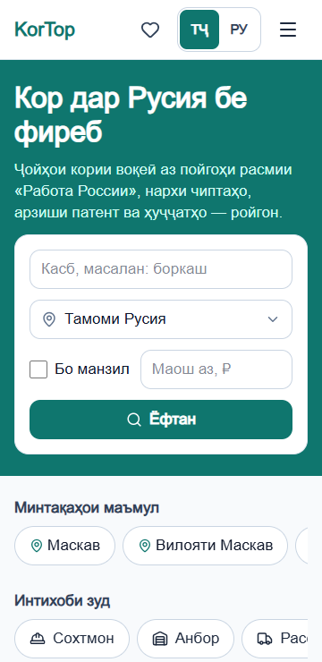
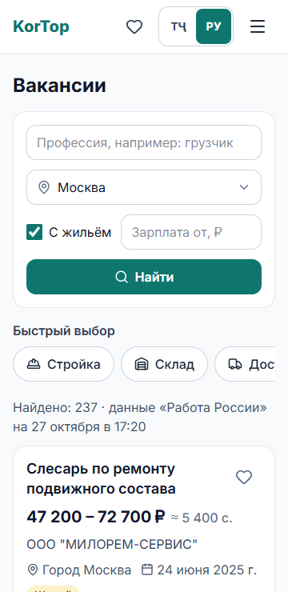
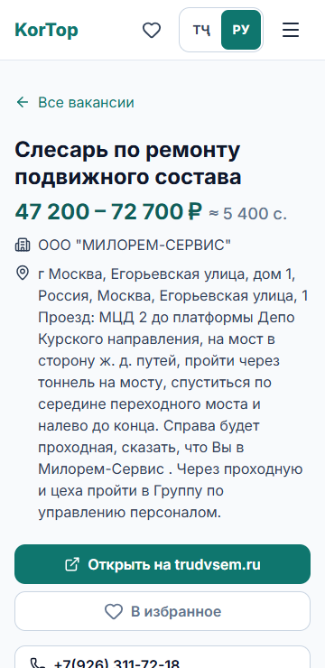
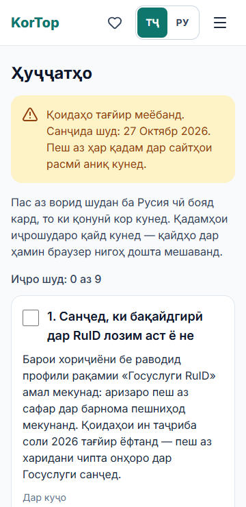

# KorTop — работа в России без обмана

Бесплатный мобильный сайт для трудовых мигрантов из Таджикистана: реальные вакансии по всей России, цены на билеты из Душанбе и Худжанда, стоимость патента с калькулятором «сколько останется», курс рубля к сомони, чек-лист документов и признаки мошенников. Интерфейс на таджикском и русском, без регистрации.

Ссылка на сайт: _появится после деплоя на Vercel_

| Главная | Вакансии | Вакансия | Документы |
| --- | --- | --- | --- |
|  |  |  |  |

## Что умеет

- **Вакансии** из официальной базы «Работа России»: поиск по профессии, все 85 регионов с поиском по названию, «с жильём», «зарплата от», быстрые категории. Фильтры хранятся в адресе — ссылкой можно поделиться.
- **Страница вакансии**: все поля, ссылка на оригинал на trudvsem.ru, телефоны, кнопки «Поделиться в Telegram / WhatsApp».
- **Избранное** в браузере: хранятся копии вакансий, поэтому они открываются, даже если вакансию сняли.
- **Калькулятор «Сколько останется»**: зарплата − патент − жильё − еда − транспорт, в рублях и сомони. На странице вакансии заполняется сам.
- **Билеты**: самые дешёвые даты из Душанбе и Худжанда по данным Aviasales.
- **Патент**: стоимость по регионам с источником и датой проверки; где проверенных данных нет — так и написано.
- **Документы**: пошаговый чек-лист со сроками и ссылками на закон, отметки сохраняются.
- **Мошенники**: 8 признаков обмана и куда обращаться.

## Откуда данные

На сайте нет выдуманных цифр: всё приходит из API или внесено вручную с официальных источников со ссылкой и датой проверки. Полный список — на странице «Источники данных» (`/sources`).

| Данные | Источник | Обновление |
| --- | --- | --- |
| Вакансии | [API «Работа России»](https://trudvsem.ru/opendata/api), без ключа | кэш 1 час |
| Билеты | [Aviasales Data API](https://support.travelpayouts.com/hc/en-us/articles/203956163) (Travelpayouts), токен | кэш 6 часов |
| Курс ₽ → сомони | Нацбанк Таджикистана, запасной — ЦБ РФ | кэш 1 сутки |
| Патент, документы, мошенники | законы и официальные сайты, файлы в `data/` | вручную |

Что выяснилось при проверке API (подробно в [docs/samples/README.md](docs/samples/README.md)):

- «Работа России» отвечает 11–18 секунд, поэтому таймаут 25 секунд, кэш и скелетоны при загрузке.
- Фильтра по зарплате в API нет — «зарплата от» отбирается на нашей стороне, об этом есть подпись.
- Признака жилья внутри вакансии нет, только фильтр `accommodation=true`.

## Технологии

Next.js 16 (App Router, Cache Components), JavaScript, Tailwind CSS 4, next-intl, lucide-react. Хостинг — Vercel.

- Страницы — серверные компоненты: данные запрашиваются на сервере через `lib/`, токены не попадают в браузер.
- Кэш — директива `'use cache'` + `cacheLife()` в функциях `lib/`.
- `"use client"` только для интерактивных частей: фильтры, избранное, калькулятор, чек-лист, переключатель языка.

## Как запустить

Нужен Node.js 20+.

```bash
npm install
cp .env.example .env.local   # вписать TRAVELPAYOUTS_TOKEN и TRAVELPAYOUTS_MARKER
npm run dev                   # http://localhost:3000
```

Без токена Travelpayouts сайт работает, а в разделе «Билеты» показывается ссылка на Aviasales вместо цен.

Проверка перед коммитом: `npm run lint` и `npm run build`.

## Структура

```
app/[locale]/   страницы (/tg/... и /ru/...)
components/     ui, layout, jobs, tickets, patent, documents, home
lib/            работа с API и форматирование (trudvsem, travelpayouts, rates, normalizeJob, format)
data/           справочники с source и checkedAt (regions, patents, documents, scams)
messages/       переводы tg.json и ru.json
hooks/          избранное и чек-лист в localStorage
docs/samples/   реальные ответы API
```

План работ — [ROADMAP.md](ROADMAP.md), требования — [PRD.md](PRD.md).

KorTop не работодатель и не берёт денег за трудоустройство.
